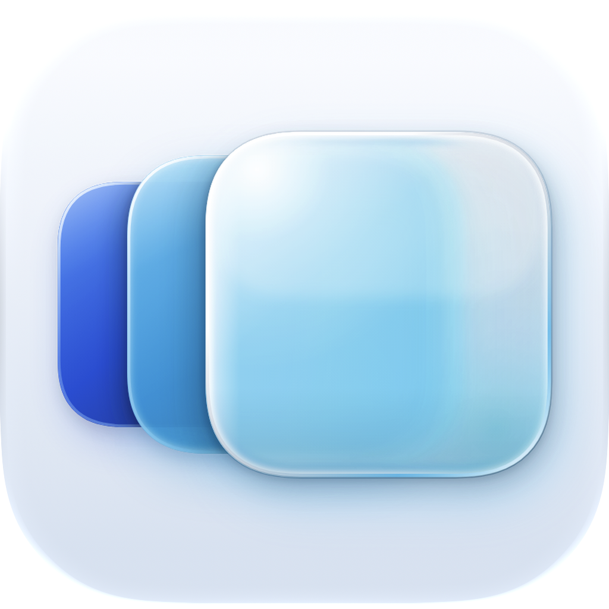
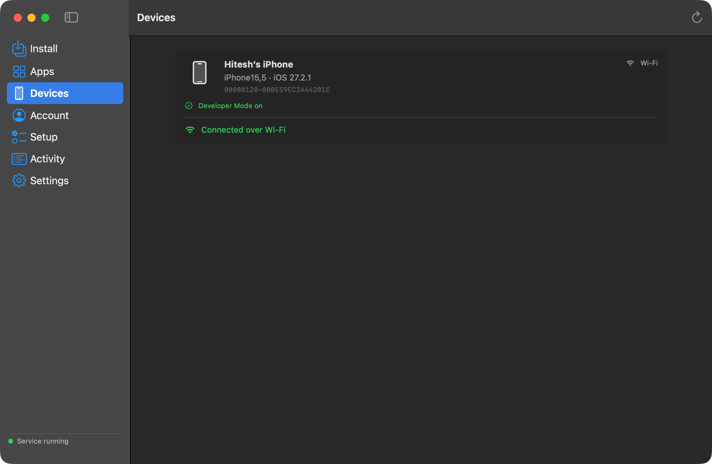
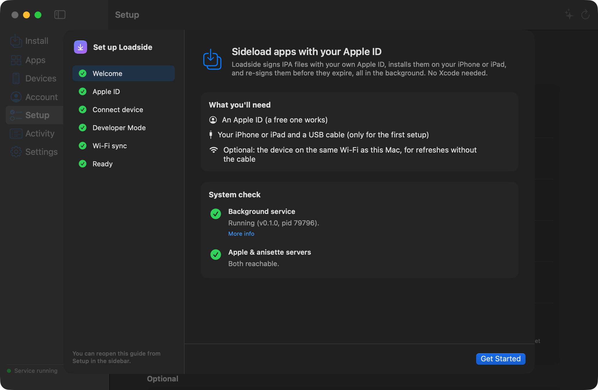
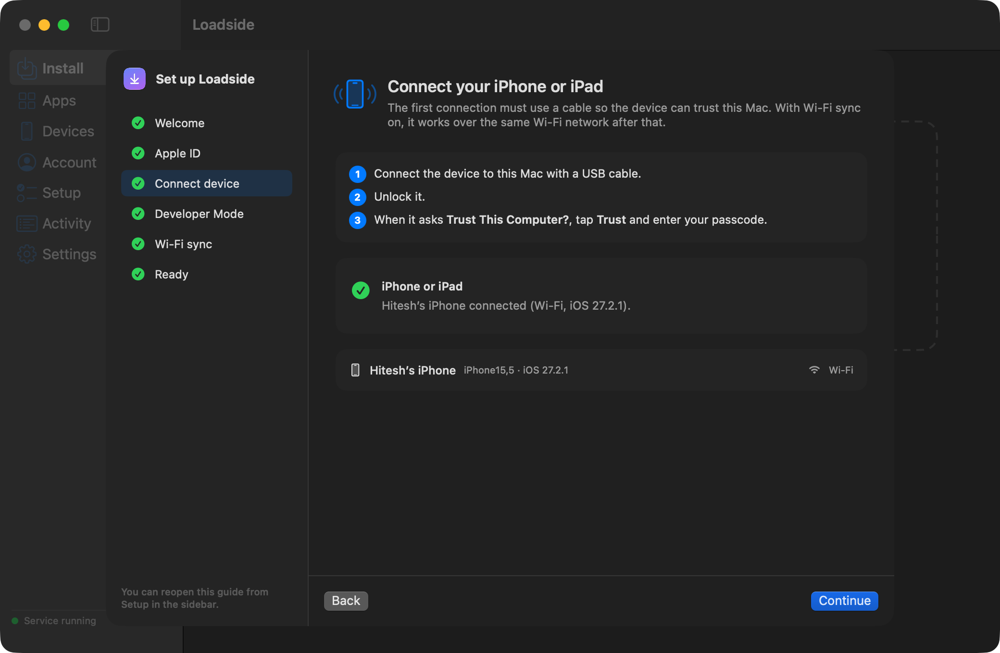
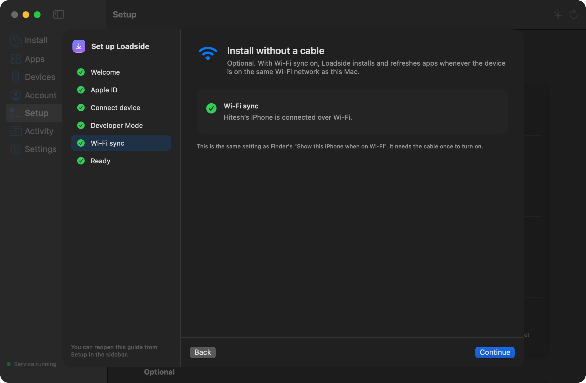
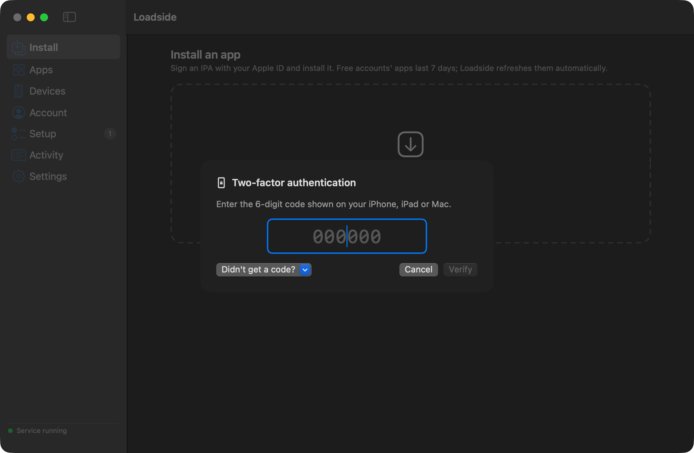
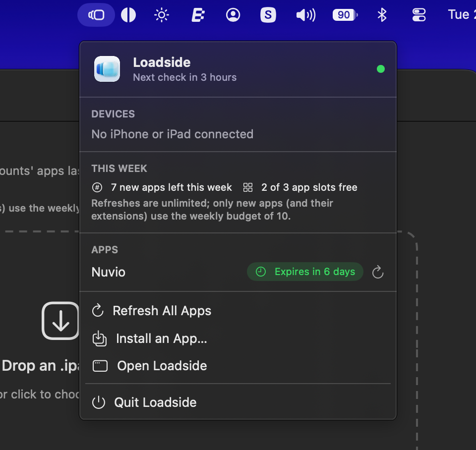

<p align="center"></p>

# Loadside

A Sideloadly-style IPA sideloader for macOS: sign iOS apps with your (free or paid) Apple ID and install them over USB or Wi-Fi, then keep them signed in the background. **No Xcode required.**

<p align="center"></p>

- **`loadsided`**: Rust background daemon (~9 MB RAM idle). It owns the Apple session, signs and installs, watches for devices, and auto-refreshes apps before their 7-day free profiles expire.
- **`Loadside.app`**: SwiftUI front end with a menu bar panel (devices, app expiry, one-click refresh). Closing the window leaves just the menu bar icon; turn the icon off in Settings and the app quits with its window instead.
- **`loadside`**: CLI client with the same features.

## Install

```bash
./scripts/install.sh        # builds everything, installs ~/Applications/Loadside.app,
                            # links ~/.local/bin/loadside, registers the LaunchAgent
open ~/Applications/Loadside.app
```

Requires the Rust toolchain and the Xcode command-line tools (for `swift build`). The Xcode IDE and an Apple developer membership are not needed.

The build signs with the first code-signing certificate in your Keychain (an "Apple Development" one from Xcode works) so the Keychain remembers "Always Allow" across rebuilds; set `LOADSIDE_SIGN_IDENTITY` to pick one, or `-` for ad-hoc signing (macOS then asks again for Keychain access after every rebuild).

## First run

The app opens a setup guide on first launch (reopen it any time from **Setup** in the sidebar). Every step shows a live check and the button that fixes it:

1. **System check:** background service running, Apple and anisette servers reachable.
2. **Apple ID:** sign in. A free Apple ID works; a secondary one is recommended. Keep "Remember password" on so refreshes run unattended (it goes into the macOS Keychain).
3. **Connect device:** cable, unlock, tap **Trust**.
4. **Developer Mode** (iOS 16+): "Show the switch" makes the toggle appear on the device; then Settings → Privacy & Security → Developer Mode → On, restart.
5. **Wi-Fi sync** (optional), see below.

After the first install, if the app says "Untrusted Developer": Settings → General → VPN & Device Management → your Apple ID → Trust.

`loadside doctor` prints the same checklist in the terminal.

| Welcome | Device | Wi-Fi sync |
| --- | --- | --- |
|  |  |  |

Two-factor codes are entered in the app (or with `loadside login` in the terminal); Apple sends them to your trusted devices.

<p align="center"> </p>

## Wi-Fi

Loadside uses macOS's own Wi-Fi sync: with **"Show this iPhone when on Wi-Fi"** on, the device appears over Wi-Fi whenever it's on the same network as this Mac, and installs and refreshes work without the cable. Turn it on from the setup guide, Devices → **Turn On Wi-Fi Sync**, or `loadside wifi-sync` (needs the cable once).

## CLI

```bash
loadside login
loadside devices
loadside inspect App.ipa
loadside install App.ipa [--bundle-id x] [--name "My App"] [--extensions register|reuse|strip] \
                         [--inject tweak.deb --inject libellekit.dylib] [--file-sharing] [--export out.ipa]
loadside apps | refresh <id> | refresh --all | remove <id> --uninstall
loadside app-ids | certs | revoke-cert <serial>
loadside doctor                                   # setup checklist
loadside wifi-sync                                # turn on Wi-Fi sync (USB)
loadside dev-mode                                 # show the Developer Mode switch on the device
loadside logs -f | config [key value] | daemon status|install|restart
```

## What's better than Sideloadly

- **Errors with fixes.** Apple, installd and lockdown errors are mapped to a plain message plus what to do (for example the free 3-app limit, 10 App IDs/week, certificate limit, a locked device, a missing Trust, an encrypted IPA). Raw details are still a click away.
- **Free-account budget, always visible.** The Install page, Apps list and menu bar show how many new apps you can still add this week and how many of the 3 per-device slots are free (refreshes don't count).
- **Free-account details.** Shows App IDs left this week and when each frees up, shows how many IDs an IPA needs before you install it, and offers "Strip extensions" when you're short.
- **Unattended auto-refresh.** Event-driven: it triggers the moment a device attaches over USB or Wi-Fi, plus a periodic check. It backs off after failures, skips apps you deleted from the phone, and sends a notification on success or failure.
- **Keeps the original IPA** in its library, so refresh works even if you delete the download.
- **Extension handling:** register all, reuse the main profile, or strip. It fixes extensions whose bundle IDs don't share the app's prefix instead of failing.
- **Tweak injection** of `.dylib`, `.framework`, `.deb` (gz/xz/zst/lzma) and `.bundle`. Load commands are inserted into the binary's header padding, CydiaSubstrate references are rewritten to the ElleKit or Substrate you supply, and it warns if a tweak needs Substrate and none was given.
- **FairPlay detection** before signing (encrypted App Store IPAs crash on launch).
- **Certificate safety.** Loadside reuses one certificate and never silently revokes other tools' certificates. If the limit is hit, it asks.
- **Export a signed IPA** without installing.
- **Your signing key stays yours.** The signing library hands the certificate *and private key* to apps that ask for it (AltStore, SideStore, LiveContainer…). Loadside only allows that after you tick "Allow this app to receive my signing key".
- **Hardened input handling.** IPA and `.deb` extraction rejects path traversal and symlink escapes and caps sizes and entry counts; the daemon socket only accepts your own user.

## Architecture

```
crates/loadside-core   IPA prep, Mach-O injection, .deb extraction, error mapping,
                       state/config, IPC protocol, client. Uses `isideload`
                       (Apple auth, developer API, signing) and `idevice` (usbmuxd,
                       lockdown, AFC, installation_proxy).
crates/loadsided       daemon: Unix socket (NDJSON), job queue, usbmuxd watcher,
                       refresh scheduler, 2FA/cert prompts, logs
crates/loadside-cli    `loadside`
app/                   SwiftUI app (SwiftPM), talks to the daemon socket
```

Data: `~/Library/Application Support/Loadside` (state, config, IPA library, socket). Logs: `~/Library/Logs/Loadside`. Secrets: Keychain (`dev.loadside.*`).

**Anisette:** Apple requires machine-provisioning headers for sign-in. Generating them locally needs entitlements unsigned apps don't get on macOS (AOSKit fails with -45070), so Loadside uses an anisette-v3 server (default `ani.iloader.app`, configurable; you can self-host one). That server never sees your credentials. Public servers report an ancient macOS (10.12), which Apple now answers with SMS-only 2FA that then fails with HTTP 403; Loadside overrides the client identity to a current Mac ("Sign in as a current Mac" in Settings), so Apple sends the normal trusted-device prompt.

## Development

```bash
cargo test                      # Mach-O injection, IPA prep/injection, error mapping
cargo run -p loadside-core --example probe_anisette   # connectivity check
LOADSIDE_HOME=/tmp/lh LOADSIDE_SOCKET=/tmp/lsd.sock cargo run -p loadsided -- -f
LOADSIDE_SOCKET=/tmp/lsd.sock swift run --package-path app
```

## Credits

Built on [isideload](https://github.com/nab138/isideload) and [idevice](https://github.com/jkcoxson/idevice). The modern client-identity workaround comes from [iloader#1203](https://github.com/nab138/iloader/issues/1203).

## License

MIT
